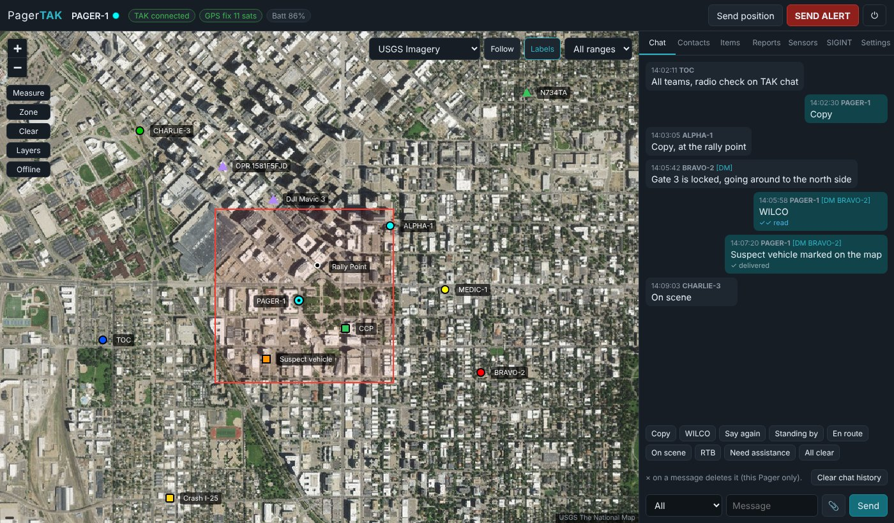
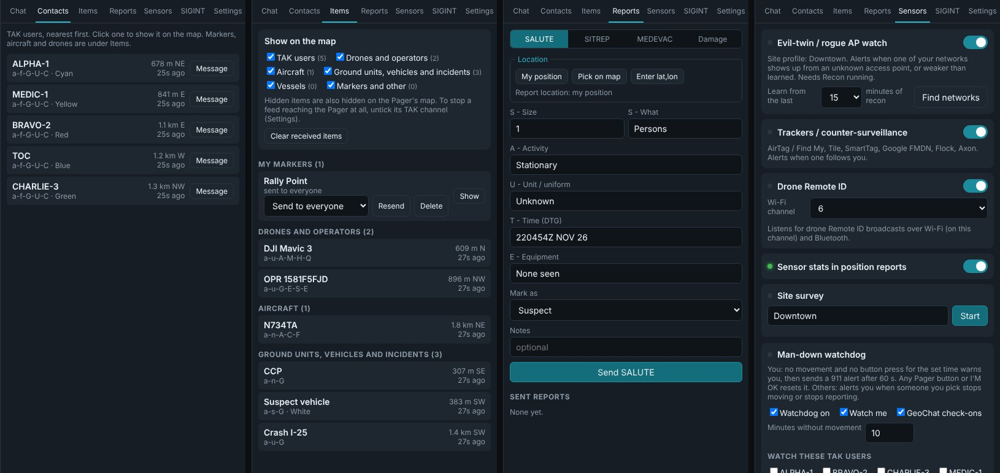
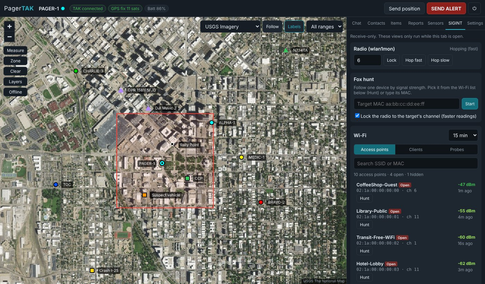
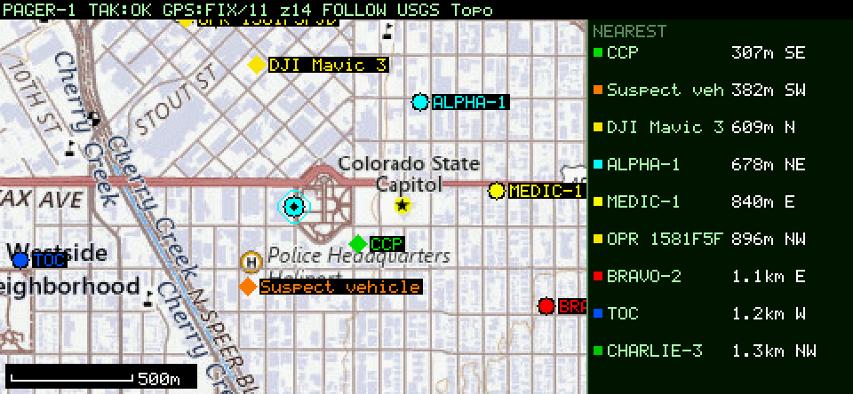
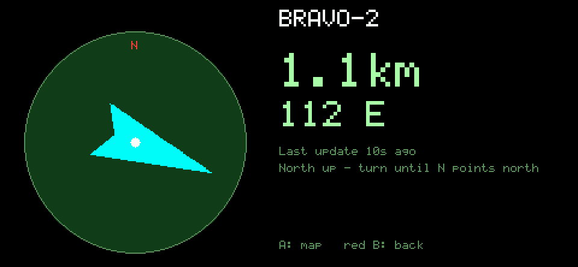

# PagerTAK – TAK payloads for the [WiFi Pineapple Pager](https://hak5.org/products/wifi-pineapple-pager)

<p align="center"></p>

[](https://www.buymeacoffee.com/sect0101)

Community payloads that connect the **Hak5 WiFi Pineapple Pager** to the **TAK** ecosystem (ATAK, WinTAK, iTAK, WebTAK, CloudTAK) over Cursor-on-Target.

**Payloads here are written in DuckyScript™ + Bash for the WiFi Pineapple Pager. They are community payloads and are not supported or guaranteed by Hak5.** See [Legal](#legal).

Have a WiFi Pineapple Mark VII? [PineappleTAK](https://github.com/SECT0101/PineappleTAK-MK7) runs the same engine and web console as a Pineapple UI module.

The layout follows the official [hak5/wifipineapplepager-payloads](https://github.com/hak5/wifipineapplepager-payloads) library, so a payload folder can be copied straight to the Pager or submitted upstream as a pull request.



<p align="center"><br><sub>On the Pager, shown with the <a href="https://github.com/SECT0101/PagerTAKTheme">TAK5 theme</a></sub></p>

---

## Payloads

| Payload | Category | Description |
|---|---|---|
| [PagerTAK](library/user/general/PagerTAK) | user / general | Puts the Pager on the TAK map: GPS position as CoT, GeoChat, alerts (911, Ring The Bell, Geo-fence Breached, Troops In Contact, Custom) to everyone or chosen contacts, SALUTE / SITREP / MEDEVAC 9-line / damage reports, a map on the Pager screen, and Wi-Fi / Bluetooth / drone sensors (evil-twin watch, tracker watch, drone Remote ID, site survey, geofences, man-down watchdog). Includes a browser **web console** with map tools, TAK channels, a SIGINT tab, offline maps, overlays and file sharing, and setup from the browser with TAK certificate enrollment. TLS 8089 / TCP 8087 / UDP. |
| [PagerTAK Deauth Alert](library/alerts/deauth_flood_detected/PagerTAK_Deauth_Alert) | alerts / deauth_flood_detected | Pushes deauth/disassoc flood detections to TAK as a map marker and GeoChat alert. Uses PagerTAK's settings. |
| [NetBird VPN](library/user/remote_access/NetBird_VPN) | user / remote_access | Installs, enrolls (setup key, cloud or self-hosted) and controls the NetBird WireGuard mesh VPN so PagerTAK can reach a TAK Server on your NetBird network. |

## Screenshots

The web console runs on the Pager and opens in any browser on your laptop or phone. These shots use made-up demo data.





On the Pager itself: the map with the nearest-contacts list, and *Navigate to* a contact.

<p align="center"> </p>

## Repository layout

```
library/
├── alerts/
│   └── deauth_flood_detected/
│       └── PagerTAK_Deauth_Alert/
│           ├── payload.sh
│           └── README.md
└── user/
    ├── remote_access/
    │   └── NetBird_VPN/
    │       ├── payload.sh
    │       └── README.md
    └── general/
        └── PagerTAK/
            ├── payload.sh      # the payload: settings, TAK connection, chat, alerts, menus (Bash + Pager DuckyScript)
            ├── README.md       # full usage and configuration
            ├── include/        # modules: reports, evil-twin watch, trackers, Remote ID, survey,
            │                   #   SIGINT (radio / fox hunt), geofences, man-down watchdog, web console glue
            ├── map/            # Pager map viewer, QR screen, Remote ID bridge, survey builder, basemaps
            ├── web/            # web console server (Python standard library) + page
            └── certs/          # your TAK client certs go here (git-ignored)
```

Each payload lives in its own folder named without spaces. The file that runs is `payload.sh`. It starts with the standard header (`# Title:`, `# Description:`, `# Author:`, `# Version:`, `# Category:`), and all configuration goes under `# Options`.

## Quick start

```bash
git clone https://github.com/SECT0101/PagerTAK
scp -r library/user/general/PagerTAK root@172.16.52.1:/root/payloads/user/general/
scp -r library/alerts/deauth_flood_detected/PagerTAK_Deauth_Alert root@172.16.52.1:/root/payloads/alerts/deauth_flood_detected/
scp -r library/user/remote_access/NetBird_VPN root@172.16.52.1:/root/payloads/user/remote_access/
```

Then on the Pager open **Payloads > User > General > PagerTAK** and set it up on the Pager or in a web browser. For TLS, the easiest certificate route is enrolling with your TAK username and password; the [payload README](library/user/general/PagerTAK/README.md) has every option.

To use PagerTAK from a laptop or phone, turn on **Settings > Web console** on the Pager and open any address it shows: the Pager's host name, its IP on your network, or `http://172.16.52.1:8484` over USB. *Show QR code* puts the address on the Pager screen for a phone.

To update, copy the new `PagerTAK` folder over the old one. Settings, certificates, zones and markers are kept. See the [changelog](CHANGELOG.md) for what changed.

## About DuckyScript on the Pager

The Pager's DuckyScript is **not** the keystroke-injection language of the USB Rubber Ducky (`STRING`, `DELAY`, `ENTER`, …). Pager payloads are Bash scripts that call all-caps Pager commands such as `LOG`, `GPS_GET`, `TEXT_PICKER`, `LIST_PICKER`, `ALERT` and `PAYLOAD_SET_CONFIG`. See the [Hak5 Pager DuckyScript reference](https://docs.hak5.org/wifi-pineapple-pager/payloads/duckyscript-for-the-wifi-pineapple-pager).

## Contributing

- One folder per payload, no spaces in names. Use an existing category.
- Use placeholders (`example.com`) for hostnames, keys and passwords. Never commit certificates.
- Test on a Pager before opening a PR. CI runs ShellCheck on every `payload.sh` and PagerTAK's `include/` modules, and syntax-checks the Python and JavaScript.

## Legal

Use these payloads only on systems and networks you own or are authorized to use.
WiFi Pineapple and DuckyScript are trademarks of Hak5 LLC. This project is not affiliated with Hak5 or the TAK Product Center.

Licensed under the [GNU GPL v3.0](LICENSE).
